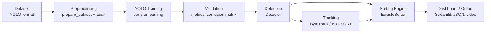

# YOLO-Based E-Waste Detection and Automatic Sorting System

A complete, config-driven computer-vision pipeline that detects electronic-waste items with an
Ultralytics YOLO model and maps every detection to a recycling category and a **simulated**
sorting destination - from dataset audit to training, evaluation, tracking, a dashboard and
model export.

> **Scope note:** this is a *vision-based prototype / simulation*. It outputs sorting
> decisions as data; it does not control hardware and is not an industrial sorting system.

## Overview

`Dataset -> audit -> YOLO fine-tuning -> validation -> detection -> tracking -> sorting decision -> dashboard / JSON / annotated media`

Everything class-specific (names, categories, bins, thresholds, colors) lives in
[`configs/config.yaml`](configs/config.yaml). Adding a class needs no Python changes.

## Problem Statement

Electronic waste is a fast-growing waste stream containing both hazardous items (e.g. batteries)
and valuable materials (boards, metals). Manual pre-sorting is slow and error-prone. This
project explores whether an off-the-shelf real-time detector can identify common e-waste
items and support a downstream sorting decision.

## Objectives

- Fine-tune a pretrained YOLO detector on e-waste classes (transfer learning).
- Keep dataset quality visible via an automated audit.
- Convert detections to structured sorting decisions with per-class confidence rules.
- Count unique objects in video via tracking.
- Provide reproducible evaluation, benchmarking (CPU vs GPU) and ONNX export.
- Stay research-extensible and GitHub-safe (no data, weights or secrets committed).

## System Architecture



| Stage | What happens | Code |
|---|---|---|
| Dataset | YOLO-format images + labels, `dataset/data.yaml` generated from the config | `dataset/`, `scripts/prepare_dataset.py` |
| Preprocessing | Import/remap external datasets, audit integrity and balance | `scripts/prepare_dataset.py`, `src/dataset_audit.py` |
| YOLO Training | Fine-tune pretrained weights; save `best.pt`, curves, summary | `src/train.py` |
| Validation | P, R, mAP50, mAP50-95, per-class metrics, confusion matrix, PR curve | `src/validate.py`, `src/evaluate.py` |
| Detection | One shared `Detector` for CLI, dashboard and evaluation | `src/inference.py`, `src/predict.py` |
| Tracking | Track IDs across frames; each object counted once | `src/track.py` |
| Sorting Engine | class -> category -> destination -> decision + counters | `src/sorting.py` |
| Dashboard / Output | Streamlit UI, JSON summaries, annotated images/videos | `app/streamlit_app.py` |

More detail: [docs/architecture.md](docs/architecture.md), [docs/methodology.md](docs/methodology.md).

## Supported E-Waste Classes

| ID | Class | Category | Simulated destination |
|---|---|---|---|
| 0 | battery | hazardous_electronic | `HAZARDOUS_ELECTRONIC_BIN` |
| 1 | mobile_phone | electronic_device | `ELECTRONIC_DEVICE_BIN` |
| 2 | pcb | electronic_component | `ELECTRONIC_COMPONENT_BIN` |
| 3 | cable | recyclable_electronic | `RECYCLABLE_ELECTRONIC_BIN` |
| 4 | plastic | plastic_recycling | `PLASTIC_RECYCLING_BIN` |
| 5 | metal | metal_recycling | `METAL_RECYCLING_BIN` |

Example output for a detected battery: `battery | 0.91 | hazardous_electronic | SEND_TO_HAZARDOUS_ELECTRONIC_BIN`.

**To add a class:** append it under `classes:` in `configs/config.yaml` (and a new
category if needed), run `python scripts/prepare_dataset.py write-yaml`, add labeled data, retrain.

## Dataset

No dataset ships with this repo. See [docs/dataset.md](docs/dataset.md) for candidate public
datasets (several CC BY 4.0 on Roboflow Universe), download steps, the class-mapping layer and
the **coverage gap** (no obvious public source for the `plastic` and `metal` classes).
Always verify each dataset's license and quality yourself.

## Methodology

Transfer learning from a pretrained Ultralytics detection checkpoint; rule-based sorting on
top of the detections. Final metrics are computed on a held-out test split. See
[docs/methodology.md](docs/methodology.md).

## Installation

```bash
git clone https://github.com/<your-username>/yolo-ewaste-detection-sorting.git
cd yolo-ewaste-detection-sorting
python -m venv .venv
# Linux/macOS: source .venv/bin/activate      Windows: .venv\Scripts\activate
pip install -r requirements.txt
python scripts/test_installation.py
```

**PyTorch note:** `ultralytics` installs a default PyTorch build. For a specific CUDA version
install PyTorch first from <https://pytorch.org/get-started/locally/>, then run
`pip install -r requirements.txt`. CPU-only machines need nothing extra (training will be slow).
Python 3.11+ recommended. Optional: copy `.env.example` to `.env` (no secrets are needed by default).

## Dataset Preparation

```bash
python scripts/prepare_dataset.py init                       # folder skeleton + data.yaml
python scripts/prepare_dataset.py convert-yolo --source downloads/<dataset> \
       --mapping configs/class_mapping.example.yaml --prefix ds1
python scripts/prepare_dataset.py audit                      # or: python src/dataset_audit.py
```

The audit writes `outputs/metrics/dataset_audit.json` and `dataset_audit.txt`.

## Training

```bash
python src/train.py                                  # settings from configs/config.yaml
python src/train.py --epochs 50 --batch 8 --device cpu
python src/train.py --model yolo11s.pt --name exp_small
```

Runs the dataset audit, prints the selected device (CUDA GPU or CPU), fine-tunes, and saves
`outputs/train/<run_name>/weights/best.pt`, `outputs/metrics/training_summary.json` and
`outputs/visualizations/training_curves.png`. Tracked: precision, recall, mAP50, mAP50-95,
training and validation losses.

## Validation

```bash
python src/validate.py --split val                   # -> outputs/metrics/metrics.json
python src/evaluate.py                               # full report on the test split
python src/evaluate.py --split val --examples 20
```

`evaluate.py` produces `metrics.json`, `summary_<split>.txt`, confusion matrices (raw and
normalized), per-class mAP, Ultralytics PR/F1 curves, training curves and annotated example
detections in `outputs/visualizations/`.

## Inference

```bash
python src/predict.py --source path/to/image.jpg
python src/predict.py --source path/to/images_folder/
python src/predict.py --source path/to/video.mp4 --conf 0.4
python src/predict.py --source img.jpg --model outputs/train/ewaste/weights/best.pt
```

Outputs annotated media (box, class, confidence, sorting category) and a
`*_summary.json` in `outputs/predictions/`.

## Real-Time Detection

```bash
python src/predict.py --source 0        # webcam index 0, press q to quit
```

Shows a live window with FPS and detection count. If the webcam cannot be opened you get an
explanatory error (try `--source 1`).

## Tracking

```bash
python src/track.py --source path/to/video.mp4
python src/track.py --source 0 --tracker botsort.yaml
```

Draws `#ID class confidence` plus the sorting category and counts each object once.
Limitation: tracker ID switches can inflate counts.

## Automatic Sorting Logic

```python
from src.config import load_config
from src.sorting import EwasteSorter

sorter = EwasteSorter(load_config())
sorter.get_category("battery")      # 'hazardous_electronic'
sorter.get_destination("pcb")       # 'ELECTRONIC_COMPONENT_BIN'
sorter.process_detection("battery", 0.91, bbox=[10, 20, 110, 90])
# {'class_name': 'battery', 'confidence': 0.91, 'category': 'hazardous_electronic',
#  'destination': 'HAZARDOUS_ELECTRONIC_BIN', 'decision': 'SEND_TO_HAZARDOUS_ELECTRONIC_BIN', ...}
sorter.summary()                    # counts by class / category / destination
```

Per-class `min_confidence` values gate decisions (batteries are stricter by default). Below the
threshold the decision is `NO_ACTION_LOW_CONFIDENCE`. Unknown class names/IDs raise `UnknownClassError`.

## Streamlit Dashboard

```bash
streamlit run app/streamlit_app.py
```

Upload an image or video, or take a webcam snapshot; choose the model and confidence threshold.
Tabs: Detection Preview, Detected Objects, Sorting Summary, Class Distribution, Model
Performance (reads `outputs/metrics/metrics.json`). Uses the same `Detector`/`EwasteSorter` as the CLI.
For continuous live webcam use the CLI.

## Evaluation Metrics

Precision, Recall, mAP@50, mAP@50-95, per-class metrics, confusion matrix, PR curve. Definitions
in [docs/methodology.md](docs/methodology.md).

## Benchmarking

```bash
python scripts/benchmark.py                          # CPU and (if available) GPU, reported separately
python scripts/benchmark.py --images dataset/images/test --runs 100 --devices cpu
```

Measures latency (mean/median/p95), FPS, model size and parameter count; results are written
to `outputs/metrics/benchmark.json`. Nothing is estimated.

Model export (ONNX; other formats via `--format`):

```bash
python scripts/export.py
python scripts/export.py --format onnx --dynamic --simplify
```

Deployment routes are listed in [docs/architecture.md](docs/architecture.md).

## Project Structure

```
yolo-ewaste-detection-sorting/
├── README.md  LICENSE  requirements.txt  pytest.ini  .gitignore  .env.example
├── configs/        config.yaml, class_mapping.example.yaml
├── dataset/        data.yaml, images/{train,val,test}, labels/{train,val,test}   (data git-ignored)
├── src/            config, errors, utils, dataset_audit, train, validate, evaluate,
│                   inference, predict, track, sorting, visualization
├── app/            streamlit_app.py
├── scripts/        prepare_dataset.py, benchmark.py, export.py, test_installation.py
├── outputs/        predictions/, metrics/, visualizations/                       (git-ignored)
├── tests/          test_config.py, test_sorting.py, test_dataset.py
└── docs/           architecture.md, dataset.md, methodology.md
```

Run the tests (no dataset, GPU or downloads needed): `pytest`

## Results

**Results will be added after training.** No experiments have been run for this repository
version; no accuracy or speed figures are claimed.

| Metric | Value |
|---|---|
| Precision | *pending* |
| Recall | *pending* |
| mAP@50 | *pending* |
| mAP@50-95 | *pending* |
| CPU / GPU FPS | *pending (run `scripts/benchmark.py`)* |

## Limitations

- Public e-waste datasets are small, uneven and may not cover `plastic`/`metal`.
- Real waste streams involve clutter, occlusion, dirt and damage that studio-style images lack.
- Visual class does not tell material composition, battery chemistry or hazards.
- Tracking-based counts are estimates; per-detection video counts are not unique objects.
- Sorting decisions are simulated; there is no hardware integration, throughput or safety model.

## Future Work

Planned research directions, **not implemented**: class-imbalance handling, hard-negative
mining, lightweight YOLO deployment, domain adaptation, cross-dataset generalization,
uncertainty-aware detection, small-object detection, real conveyor-belt data, synthetic-to-real
transfer, quantization, edge deployment.

## Ethical/Safety Considerations

- Do not use this prototype to make safety-critical handling decisions; lithium batteries and
  other hazardous items must be handled by trained personnel under local regulations.
- Check dataset licenses and give attribution (e.g. CC BY 4.0). Do not commit data or weights.
- Avoid capturing people or private information in images/videos; obtain consent where needed.
- Report metrics honestly, including failure cases and class-level weaknesses.
- Never commit secrets; `.env` is git-ignored.

## License

Code: MIT (see [LICENSE](LICENSE); replace `<YOUR NAME>` with your name). Datasets and
pretrained weights are governed by their own licenses (Ultralytics models are AGPL-3.0 unless
you hold an enterprise license - review this before commercial use).
"# yolo-ewaste-detection-sorting" 
