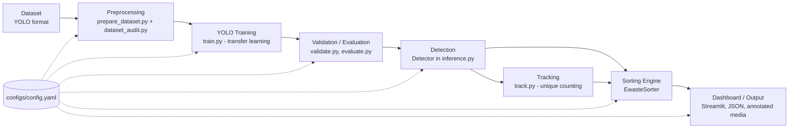

# Architecture



## Design principles

1. **One source of truth.** `configs/config.yaml` defines classes, categories, destinations,
   thresholds, colors and all hyper-parameters. `dataset/data.yaml` is *generated* from it
   (`python scripts/prepare_dataset.py write-yaml`) and checked for consistency at run time.
2. **One inference path.** `src/inference.py::Detector` wraps the Ultralytics model and the
   `EwasteSorter`. `predict.py`, `track.py`, `evaluate.py`, `scripts/benchmark.py` and the
   Streamlit app all use it, so results are identical everywhere.
3. **Detection is separated from decision-making.** YOLO only says *what* and *where*;
   `EwasteSorter` decides *category* and *destination* using config rules and thresholds.
4. **No heavy imports in the core.** `config`, `sorting`, `dataset_audit` and `utils` import
   torch/ultralytics lazily, so unit tests run without GPU, weights or datasets.
5. **Fail loudly and helpfully.** All expected failures raise `EwasteError` subclasses
   (`src/errors.py`); CLIs print a one-line explanation and exit non-zero.

## Modules

| Module | Responsibility |
|---|---|
| `src/config.py` | Load/validate YAML, typed `ClassSpec`, path resolution, overrides |
| `src/errors.py` | Exception hierarchy |
| `src/utils.py` | Logging, device selection, weights resolution, model loading, `data.yaml` handling, source parsing |
| `src/dataset_audit.py` | Dataset integrity audit (JSON + text report) |
| `src/train.py` | Transfer-learning training, training summary + curves |
| `src/validate.py` | Ultralytics validation -> `metrics.json` + summary |
| `src/evaluate.py` | Validation + confusion matrix, PR curves, example detections |
| `src/inference.py` | `Detector`: predict/track + sorting |
| `src/sorting.py` | `EwasteSorter`: class -> category -> destination -> decision, counters |
| `src/predict.py` | CLI for image / folder / video / webcam |
| `src/track.py` | CLI for tracking + unique counting |
| `src/visualization.py` | Drawing and plots (all from real data) |
| `app/streamlit_app.py` | Dashboard |
| `scripts/*` | Dataset prep, benchmark, ONNX export, installation check |

## Data contracts

Detection dict (from `Detector`):

```json
{"class_id": 0, "class_name": "battery", "confidence": 0.91, "bbox": [x1, y1, x2, y2],
 "track_id": null, "category": "hazardous_electronic",
 "destination": "HAZARDOUS_ELECTRONIC_BIN", "decision": "SEND_TO_HAZARDOUS_ELECTRONIC_BIN",
 "accepted": true, "min_confidence": 0.4, "already_counted": false, "model_class_id": 0}
```

Detections below the class threshold are not returned; they are counted in
`summary()["rejected_low_confidence"]`.

## Deployment targets (after `python scripts/export.py`)

| Target | Route |
|---|---|
| CPU server / desktop | ONNX + ONNX Runtime |
| Intel CPU/iGPU / edge boxes | OpenVINO (`--format openvino`) |
| NVIDIA GPU / Jetson | TensorRT (`--format engine`, requires TensorRT on the target device) |
| Mobile / embedded | TFLite (`--format tflite`) or NCNN, subject to Ultralytics support |
| Browser | ONNX Runtime Web (custom pre/post-processing required) |

These routes are supported by the Ultralytics exporter but **have not been validated in this
repository**; verify accuracy and speed on the target hardware.
